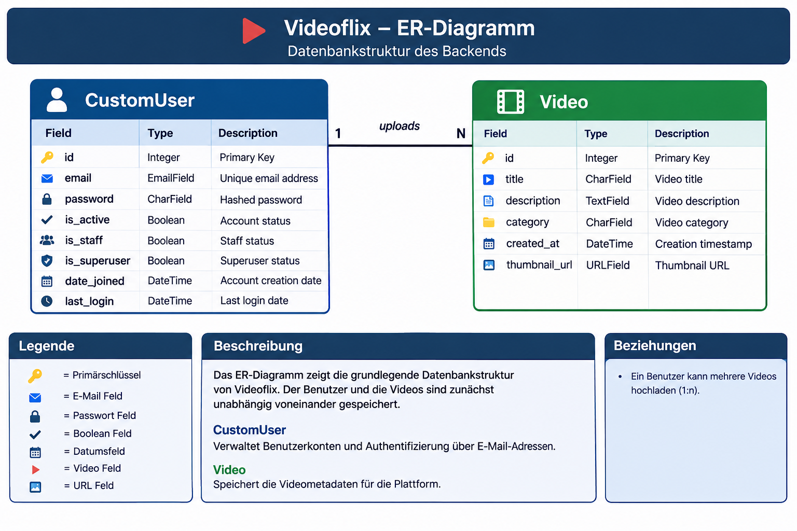

# Videoflix Backend

The Django REST API for **Videoflix** – a video streaming platform that allows users to browse and stream movies and video content.

The backend manages user accounts, authentication, video metadata, and protected HLS video streaming. It provides the API used by the Videoflix frontend.

**Project Status:** Under development. The initial Django project structure, custom user model, environment configuration, and database migrations have been set up. Authentication, video management, and HLS streaming functionality are being implemented incrementally.

---

## Table of Contents

- [Features](#features)
- [Technologies](#technologies)
- [Project Structure](#project-structure)
- [Architecture and Database Model](#architecture-and-database-model)
- [API Documentation](#api-documentation)
- [Installation and Setup](#installation-and-setup)
- [Environment Variables](#environment-variables)
- [Tests](#tests)
- [Security](#security)
- [Error Handling](#error-handling)
- [Development Workflow](#development-workflow)
- [Git Commit Conventions](#git-commit-conventions)
- [License and Usage](#license-and-usage)

---

## Features

The backend is being developed to provide the following functionality:

- User registration with email address and password
- Email-based account activation
- User login and logout
- JWT authentication using HTTP-only cookies
- Access and refresh token management
- Refreshing expired access tokens
- Password reset via email
- Video metadata management
- Retrieving available movies and video information
- Categorizing videos
- Protected HLS video streaming
- Serving HLS playlists and video segments
- Secure access to video content for authenticated users
- Automated tests for API endpoints, authentication, and video streaming

Features will be marked as implemented once they are completed and tested.

## Technologies

| Technology | Purpose |
|---|---|
| Python 3.13 | Programming language |
| Django | Backend framework |
| Django REST Framework | REST API |
| djangorestframework-simplejwt | JWT authentication |
| django-cors-headers | Cross-Origin Resource Sharing |
| SQLite | Local development database |
| python-dotenv | Loading environment variables |
| HLS | HTTP Live Streaming |
| HLS.js | Frontend video playback |
| Django Email | Sending registration and password reset emails |
| Django Test Framework | Automated testing |

## Project Structure

The following structure represents the planned backend architecture. Additional files and directories will be added as development progresses.

```text
videoflix-backend/
│
├── auth_app/
│   ├── api/
│   │   ├── __init__.py
│   │   ├── serializers.py
│   │   └── views.py
│   ├── migrations/
│   ├── services/
│   │   ├── __init__.py
│   │   ├── authentication.py
│   │   ├── registration.py
│   │   └── tokens.py
│   ├── tests/
│   ├── __init__.py
│   ├── admin.py
│   ├── apps.py
│   └── models.py
│
├── video_app/
│   ├── api/
│   │   ├── __init__.py
│   │   ├── serializers.py
│   │   └── views.py
│   ├── migrations/
│   ├── services/
│   │   ├── __init__.py
│   │   └── hls.py
│   ├── tests/
│   ├── __init__.py
│   ├── admin.py
│   ├── apps.py
│   └── models.py
│
├── core/
│   ├── __init__.py
│   ├── settings.py
│   ├── urls.py
│   ├── asgi.py
│   └── wsgi.py
│
├── docs/
│   └── er-diagram.png
│
├── .env
├── .env.example
├── .gitignore
├── manage.py
├── requirements.txt
└── README.md
```

The project uses two main Django applications:

**auth_app**

Responsible for user management, registration, email activation, authentication, JWT token handling, and password resets.

**video_app**

Responsible for video metadata, video categories, and protected HLS streaming.

The central project configuration and API routing are managed in `core/`.

The structure above describes the intended architecture. It will be updated to reflect the actual implementation.

## Architecture and Database Model

The backend uses Django's custom user model to authenticate users through their email addresses instead of usernames.

The main database entities are:

- `CustomUser`
- `Video`

Additional models may be introduced if required by the final implementation.

### Entity Relationship Diagram

The following diagram illustrates the planned database structure.



**Note:** The `CustomUser` model is already implemented. The `Video` model and its fields represent the planned database structure and will be updated once the model is implemented.

### CustomUser

The project uses a custom Django user model based on `AbstractUser`.

Important fields include:

| Field | Description |
|---|---|
| `id` | Primary key |
| `email` | Unique email address used for authentication |
| `password` | Hashed password |
| `is_active` | Indicates whether the account is active |
| `is_staff` | Determines access to the Django administration area |
| `is_superuser` | Determines administrative permissions |
| `date_joined` | Account creation timestamp |
| `last_login` | Last login timestamp |

New users must activate their accounts through an email confirmation link before they can log in.

Passwords are handled through Django's password hashing mechanisms and are never stored in plain text.

### Video

The video model stores the metadata required by the frontend.

Planned fields include:

| Field | Description |
|---|---|
| `id` | Primary key |
| `title` | Video title |
| `description` | Video description |
| `category` | Video category |
| `created_at` | Creation timestamp |
| `thumbnail_url` | URL or path to the video thumbnail |

Additional fields may be introduced for managing video files, HLS resolutions, and streaming paths.

### Relationships

The user and video models are independent in the initial architecture.

No direct relationship between these entities is currently defined. Additional relationships can be introduced if required by future functionality.

## API Documentation

**Base URL for local development:**

```text
http://127.0.0.1:8000
```

All API endpoints use the `/api/` prefix.

The API uses JSON for request and response bodies unless stated otherwise.

### Endpoint Overview

The following endpoints are defined by the project requirements. Their request and response behavior will be documented and verified during implementation.

| Method | Endpoint | Description | Authentication |
|---|---|---|---|
| POST | `/api/register/` | Register a new user | No |
| GET | `/api/activate/<uidb64>/<token>/` | Activate a user account | No |
| POST | `/api/login/` | Log in a user | No |
| POST | `/api/logout/` | Log out a user | Yes |
| POST | `/api/token/refresh/` | Refresh the access token | Refresh cookie |
| POST | `/api/password_reset/` | Request a password reset | No |
| POST | `/api/password_confirm/<uidb64>/<token>/` | Set a new password | No |
| GET | `/api/video/` | Retrieve available videos | Yes |
| GET | `/api/video/<movie_id>/<resolution>/index.m3u8` | Retrieve an HLS playlist | Yes |
| GET | `/api/video/<movie_id>/<resolution>/<segment>/` | Retrieve an HLS segment | Yes |

### Authentication

Authentication is based on JSON Web Tokens (JWT).

The access and refresh tokens are stored in HTTP-only cookies:

- `access_token` – Used to authenticate protected API requests.
- `refresh_token` – Used to obtain a new access token.

The frontend sends requests with credentials enabled so that the browser includes the authentication cookies.

The server validates the tokens and controls access to protected endpoints.

Cookie security settings, CORS, and CSRF protection must be configured appropriately for development and production environments.

### 1. Register a User

`POST /api/register/`

Registers a new user using an email address and password.

The registration process includes:

1. Validate the submitted email address.
2. Ensure that the email address is unique.
3. Validate the password.
4. Verify the password confirmation.
5. Create an inactive user account.
6. Send an account activation email.

The account cannot be used to log in before activation.

### 2. Activate a User

`GET /api/activate/<uidb64>/<token>/`

Activates a registered user through the activation link sent by email.

The activation token must be valid and associated with the corresponding user.

### 3. Log In

`POST /api/login/`

Authenticates a user using their email address and password.

Only active accounts are allowed to log in.

After successful authentication, the server sets the access and refresh token cookies.

### 4. Log Out

`POST /api/logout/`

Ends the authenticated session.

The refresh token is invalidated using the SimpleJWT blacklist functionality, and the authentication cookies are cleared.

### 5. Refresh the Access Token

`POST /api/token/refresh/`

Obtains a new access token using the refresh token stored in the HTTP-only cookie.

The refresh token is read from the cookie rather than the request body.

### 6. Request a Password Reset

`POST /api/password_reset/`

Allows users to request a password reset email.

For security reasons, the response must not reveal whether an email address is registered in the system.

### 7. Confirm a Password Reset

`POST /api/password_confirm/<uidb64>/<token>/`

Validates the password reset token and allows the user to set a new password.

### 8. Retrieve Videos

`GET /api/video/`

Returns the available videos as a JSON array.

The response includes the video metadata required by the frontend, including:

- `id`
- `title`
- `description`
- `category`
- `created_at`
- `thumbnail_url`

The frontend uses the category information to group videos and the creation timestamp to identify recently added videos.

### 9. Retrieve an HLS Playlist

`GET /api/video/<movie_id>/<resolution>/index.m3u8`

Returns the HLS playlist for the requested video and resolution.

The endpoint requires authentication.

### 10. Retrieve an HLS Segment

`GET /api/video/<movie_id>/<resolution>/<segment>/`

Returns an individual HLS video segment.

The endpoint requires authentication and validates the requested video, resolution, and segment path.

Both playlists and video segments must be protected against unauthorized access.

## Installation and Setup

### Requirements

The following tools are required for local development:

- Python 3.13
- Git
- pip
- Visual Studio Code (recommended)
- A terminal such as Windows PowerShell

### 1. Clone the Repository

Open Windows PowerShell and navigate to the directory where you want to store the project.

Clone the repository:

```powershell
git clone https://github.com/Frank-Meck/videoflix-backend.git
```

Navigate into the project directory:

```powershell
cd videoflix-backend
```

### 2. Open the Project in Visual Studio Code

If Visual Studio Code is installed and the `code` command is available, run:

```powershell
code .
```

Alternatively:

1. Open Visual Studio Code.
2. Select **File → Open Folder**.
3. Navigate to the cloned `videoflix-backend` directory.
4. Select the folder containing `manage.py` and `requirements.txt`.

### 3. Check the Python Installation

Check the installed Python version:

```powershell
python --version
```

The project currently uses Python 3.13.

If Python is not recognized, make sure it is installed and available in your system PATH.

### 4. Create a Virtual Environment

Create a virtual environment inside the project directory:

```powershell
python -m venv .venv
```

A virtual environment keeps the project's Python dependencies isolated from other Python projects.

### 5. Activate the Virtual Environment

Activate the environment using Windows PowerShell:

```powershell
.\.venv\Scripts\Activate.ps1
```

After successful activation, the terminal prompt should display:

```text
(.venv)
```

**Note:** If PowerShell blocks script execution, temporarily adjust the execution policy for the current terminal session:

```powershell
Set-ExecutionPolicy -Scope Process -ExecutionPolicy RemoteSigned
```

Then activate the virtual environment again:

```powershell
.\.venv\Scripts\Activate.ps1
```

### 6. Upgrade pip

Upgrade the Python package installer:

```powershell
python -m pip install --upgrade pip
```

### 7. Install Dependencies

Install all required Python packages from `requirements.txt`:

```powershell
python -m pip install -r requirements.txt
```

### 8. Configure Environment Variables

Create a local `.env` file using `.env.example` as a template:

```powershell
Copy-Item .env.example .env
```

Open the `.env` file in Visual Studio Code and configure the required values.

Generate a Django secret key using:

```powershell
python -c "from django.core.management.utils import get_random_secret_key; print(get_random_secret_key())"
```

Copy the generated key into the `SECRET_KEY` variable in your `.env` file.

See the [Environment Variables](#environment-variables) section for details.

**Important:**

- Never commit your `.env` file to Git.
- Never publish your Django secret key.
- The `.env.example` file is a template and must not contain real credentials.
- `DEBUG=True` must only be used for local development.

### 9. Apply Database Migrations

Initialize the local database:

```powershell
python manage.py migrate
```

This applies all available Django migrations and creates the required Django database tables.

### 10. Create an Administrator Account (Optional)

To access the Django administration area, create a superuser:

```powershell
python manage.py createsuperuser
```

Follow the instructions in the terminal.

### 11. Start the Development Server

Start the Django development server:

```powershell
python manage.py runserver
```

The backend is now available at:

```text
http://127.0.0.1:8000/
```

The REST API is available under:

```text
http://127.0.0.1:8000/api/
```

The backend does not serve the frontend application. The frontend runs separately and communicates with the backend through the REST API.

## Environment Variables

The application loads its configuration from the `.env` file in the backend root directory.

The current environment configuration includes:

| Variable | Description | Example |
|---|---|---|
| `SECRET_KEY` | Django secret key | Generated secret key |
| `DEBUG` | Enables or disables debug mode | `True` or `False` |
| `ALLOWED_HOSTS` | Permitted hostnames | `127.0.0.1,localhost` |
| `EMAIL_BACKEND` | Django email backend | Console email backend |
| `DEFAULT_FROM_EMAIL` | Default sender address | `Videoflix <noreply@videoflix.local>` |

### Example Configuration

```dotenv
SECRET_KEY=your_generated_secret_key
DEBUG=True
ALLOWED_HOSTS=127.0.0.1,localhost

EMAIL_BACKEND=django.core.mail.backends.console.EmailBackend
DEFAULT_FROM_EMAIL=Videoflix <noreply@videoflix.local>
```

For local development, the console email backend prints email content to the terminal instead of sending actual emails.

Production email settings will be documented when SMTP configuration is implemented.

## Tests

The project uses Django's testing framework and Django REST Framework's API testing utilities.

The test suite will cover:

- User registration
- Email activation
- Login and logout
- JWT cookie handling
- Token refresh
- Password reset
- Video API responses
- HLS playlist access
- HLS segment access
- Authentication and permission checks
- Invalid requests and error handling

### Run All Tests

Run the Django test suite:

```powershell
python manage.py test
```

### Run Tests for a Specific Application

For authentication:

```powershell
python manage.py test auth_app
```

For video functionality:

```powershell
python manage.py test video_app
```

### Test Coverage

The project aims for at least 95% test coverage.

Coverage measurement will be documented once the test tooling and configuration have been finalized.

## Security

Security is an important part of the Videoflix backend.

The implementation follows these principles:

- Use Django's password hashing mechanisms.
- Store JWT access and refresh tokens in HTTP-only cookies.
- Invalidate refresh tokens on logout.
- Protect private API endpoints with authentication.
- Require active accounts for login.
- Validate activation and password reset tokens.
- Avoid revealing whether an email address exists during password reset.
- Configure CORS for the authorized frontend origin only.
- Maintain CSRF protection for cookie-authenticated requests.
- Never expose secret keys or credentials in source code.
- Validate requested HLS paths and video resources.
- Prevent unauthorized access to video playlists and segments.
- Use HTTPS in production environments.

## Error Handling

The API uses appropriate HTTP status codes and JSON responses to communicate errors.

Error handling will cover:

- Invalid request data
- Missing required fields
- Duplicate email addresses
- Invalid or expired activation tokens
- Invalid login credentials
- Inactive user accounts
- Invalid or expired JWTs
- Missing refresh tokens
- Invalid password reset tokens
- Non-existent videos
- Unsupported video resolutions
- Missing HLS playlists or segments
- Unauthorized access
- Unexpected server errors

Sensitive information, credentials, and internal implementation details must never be exposed in error responses.

## Development Workflow

The backend is developed incrementally using a structured workflow.

The development process follows these principles:

1. Analyze the requirements and existing frontend implementation.
2. Define the expected API behavior.
3. Plan the backend implementation.
4. Write tests for the expected behavior.
5. Implement the functionality.
6. Run tests and resolve errors.
7. Verify compatibility with the frontend.
8. Review the implementation before committing changes.
9. Update the documentation when functionality changes.

The project follows a test-driven development approach wherever practical.

Changes are implemented step by step to maintain a clear and maintainable codebase.

## Git Commit Conventions

Commit messages follow the Conventional Commits format:

```text
type: short description
```

The following commit types are used:

| Type | Purpose |
|---|---|
| `feat` | New functionality |
| `fix` | Bug fixes |
| `docs` | Documentation |
| `style` | Formatting only |
| `refactor` | Code restructuring |
| `perf` | Performance improvements |
| `test` | Tests |
| `chore` | Maintenance and configuration |
| `build` | Build system and dependencies |
| `ci` | CI/CD pipelines |
| `revert` | Reverting previous changes |

### Examples

```text
feat: add user registration endpoint
feat: implement JWT cookie authentication
feat: add protected HLS video streaming
fix: validate refresh token expiration
test: add authentication endpoint tests
docs: update API documentation
build: update Python dependencies
chore: update gitignore
ci: add GitHub Actions workflow
```

## License and Usage

No license file is currently included in this repository.

The license and usage terms will be determined according to the project owner's requirements.

The project is currently under development and is not yet considered production-ready.
